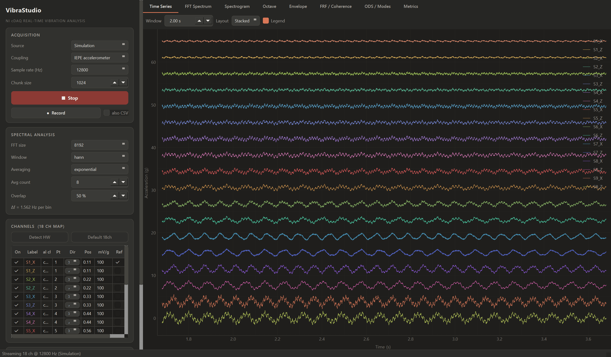
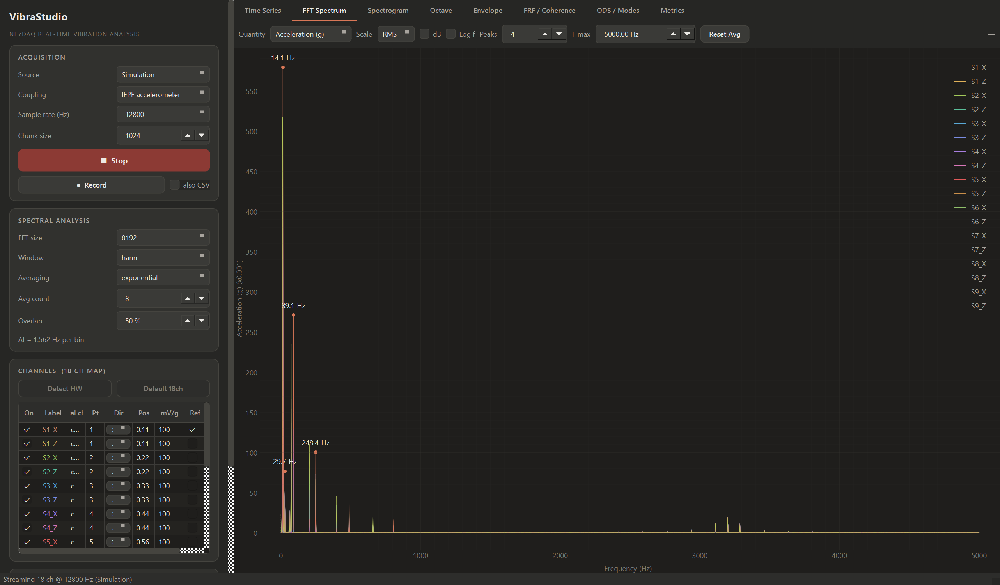
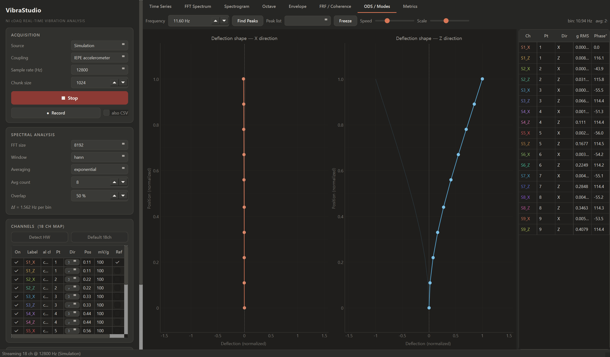

# VibraStudio — NI cDAQ 실시간 진동 해석 스위트

NI cDAQ-9189 + NI-9230(IEPE) 가속도계 시스템을 위한 **18채널 실시간 진동 해석** 데스크톱 애플리케이션입니다.
LabVIEW Sound & Vibration Measurement Suite의 핵심 예제(FFT Analysis, Octave Analysis,
Vibration Level, Frequency Response, Envelope Detection, ODS)를 벤치마킹하여
Python(PySide6 + pyqtgraph)으로 구현했습니다.



## 주요 기능

| 탭 | 기능 | LabVIEW 대응 예제 |
|---|---|---|
| **Time Series** | 18채널 실시간 시계열 (Overlay / Stacked) | Cont Acq&Graph |
| **FFT Spectrum** | 윈도우/평균화(Linear·Exponential·Peak-Hold)·오버랩 FFT, RMS/Peak/dB, 가속도→속도(mm/s)→변위(µm) 주파수영역 적분, PSD(g²/Hz), 피크 자동 라벨, 커서 판독 | Zoom FFT / Power Spectrum |
| **Spectrogram** | 롤링 STFT 워터폴 (inferno 컬러맵, dB) | STFT / Waterfall |
| **Octave** | IEC 61260 1/1·1/3 옥타브 밴드 레벨 | Octave Analysis |
| **Envelope** | 대역통과 + Hilbert 포락선 스펙트럼 (베어링 결함 진단) | Envelope Detection |
| **FRF / Coherence** | 기준 채널 대비 H1 전달률(Transmissibility), 위상, Coherence | Frequency Response (SVXMPL) |
| **Impact Test** | 임팩트 해머 모달 시험 — 레벨 트리거(프리트리거) 자동 캡처, Force/Exponential 윈도우, 타격 평균 **H1 FRF + Coherence**, 고유주파수·감쇠비(half-power, 지수윈도우 보정)·모드형상 자동 추출, 더블히트 자동 리젝트, **응답 방향 필터**(X/Y/Z별 모드 분리), **결과 저장**(frf.csv·modes.csv·raw_hits.npz·meta.json·화면 캡처), 외팔보 이론 기반 **최적 타격 위치 가이드**(모드 노드 회피 표시) | Impact Test (SVMS) |
| **ODS / Modes** | 선택 주파수에서의 운전변형형상(ODS)을 **3D 구조 위에 실시간 애니메이션** — 진폭(자기스펙트럼) + 상대위상(크로스스펙트럼), 피크 자동 탐색. 구조는 파라메트릭 템플릿(보/평판/링/원통 — 예: 12노드×2층 원통)으로 빌드하고 채널을 노드·방향(X/Y/Z)에 자동 매핑 | ODS / Modal 측정 |
| **Metrics** | 채널별 RMS·Peak·Crest·Kurtosis·Skew·지배주파수 라이브 테이블, 충격성(베어링 손상 의심) 플래그 | Vibration Level |

- **레코딩**: 스트리밍 중 NPZ(+메타데이터 JSON, 옵션 CSV) 저장
- **채널 맵**: 18채널(9포인트 × X/Z) 기본 템플릿, 하드웨어 자동 탐지, 포인트/방향/위치/감도(mV/g)/기준 채널 편집, JSON 설정 저장/불러오기
- **시뮬레이션 모드**: 하드웨어 없이 캔틸레버 보 모달 응답(5개 모드 + 회전기계 톤 + 베어링 결함 신호)으로 전 기능 시연 가능




## 실행 파일 (권장 — Python 설치 불필요)

```powershell
# 빌드 (개발 PC에서 1회)
powershell -ExecutionPolicy Bypass -File packaging\build_exe.ps1
```

빌드 결과물 `dist\VibraStudio\VibraStudio.exe` 를 더블클릭하면 바로 실행됩니다.
`dist\VibraStudio` 폴더를 통째로 복사하면 다른 PC에서도 동작합니다
(하드웨어 사용 시 해당 PC에 NI-DAQmx 드라이버만 필요, 시뮬레이션은 아무것도 필요 없음).

## 설치

```powershell
# 1) NI-DAQmx 드라이버 설치 (NI Package Manager) — 시뮬레이션만 쓸 경우 생략 가능
# 2) Python 3.10+ 가상환경
python -m venv .venv312
.\.venv312\Scripts\python.exe -m pip install -r requirements.txt
```

## 실행

```powershell
# 하드웨어 자동 탐지 (없으면 시뮬레이션으로 시작)
.\.venv312\Scripts\python.exe run_app.py

# 시뮬레이션 강제
.\.venv312\Scripts\python.exe run_app.py --simulate
```

1. **Source**에서 Hardware / Simulation 선택 → 샘플링 레이트(NI-9230 최대 12.8 kS/s) 확인
2. **Channels** 카드에서 `Detect HW`로 실제 채널 매핑(현재 4개 센서 연결 시 4채널 자동 인식), 또는 `Default 18ch` 템플릿 사용. 센서 위치(Pos 0~1)·방향(X/Z)·감도(mV/g)·기준(Ref) 채널 설정
3. **▶ Start Streaming** → 탭별 실시간 해석
4. ODS 탭: 스트리밍 상태에서 `Find Peaks` → 피크 선택 → 3D 변형 형상 애니메이션 (`Freeze`로 고정)
5. ODS 3D 구조 빌더: `Shape`(Line/Grid/Circle/Cylinder) 선택 → 파라미터(노드 수·층 수) 입력 →
   `Build Structure` → `Auto-map Channels`(X+Z / X+Y+Z / 단축 매핑). 예: Cylinder, 12 nodes/ring, 2 layers
   = 12노드×2층 원통. 매핑은 채널 테이블의 Pt(노드 id)·Dir 열로 직접 수정 가능하며 Save Config에 함께 저장됨

## 아키텍처

```
vibrastudio/
├── config.py          # 채널 맵 / 수집 / 해석 설정 (JSON 직렬화)
├── daq/
│   ├── engine.py      # NI-DAQmx 연속 수집 백엔드, 링버퍼, 스트리밍 스레드
│   └── simulator.py   # 캔틸레버 모달 응답 시뮬레이터 (실시간 페이싱)
├── dsp/
│   └── analysis.py    # StreamingAnalyzer: 평균화 자기/크로스 스펙트럼,
│                      #  PSD, 적분, FRF/Coherence, ODS, 옥타브, 포락선, 메트릭
├── recorder.py        # 스트림 레코더 (NPZ/CSV, 별도 writer 스레드)
└── ui/
    ├── theme.py       # 다크 테마 (QSS + pyqtgraph)
    ├── panels.py      # 사이드바: 수집/해석/채널/상태 카드
    ├── views.py       # Time/Spectrum/Spectrogram/Octave/Envelope/FRF/Metrics
    ├── ods_view.py    # ODS 애니메이션 뷰
    └── main_window.py # 엔진-분석기-뷰 배선, GUI 틱(60 ms)
```

**신호 처리 방식** — 수집 스레드가 링버퍼에 적재하면 GUI 틱마다 새 샘플을
`StreamingAnalyzer`에 공급합니다. 분석기는 오버랩 블록 단위로 `Sxx = ⟨|X|²⟩`,
`Sxy = ⟨X*ref·X⟩`(기준 채널 크로스 스펙트럼)를 평균화하며, 표시 시점에
Peak/RMS/PSD/dB 스케일과 윈도우 보정(S1/S2)을 적용하므로 단위를 바꿔도
평균 상태가 유지됩니다. ODS는 자기스펙트럼 진폭 + 크로스스펙트럼 상대위상을
사용하는 표준 spectral-ODS 기법입니다.

## 검증

시뮬레이션 모드 스모크 테스트로 검증되었습니다: 18채널 스트리밍 시작 → 8개 탭
전부 렌더 → ODS 피크 탐색(시뮬레이터 모드 주파수 11.6/29.5/72.9/204/400 Hz 검출)
→ 레코딩 시작/정지 → 정상 종료.

## 레거시 스크립트

초기 테스트 스크립트는 [legacy/](legacy/)로 이동했습니다
(단일 채널 뷰어, 10초 캡처, 캡처 후 모달 분석 GUI).

## 요구 사항

- Windows + NI-DAQmx 런타임 (하드웨어 사용 시)
- Python 3.10+, PySide6, pyqtgraph, numpy, scipy, nidaqmx
