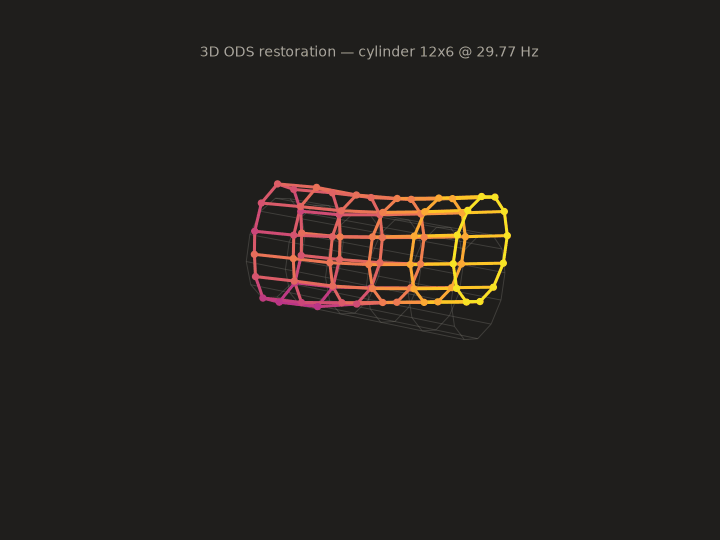
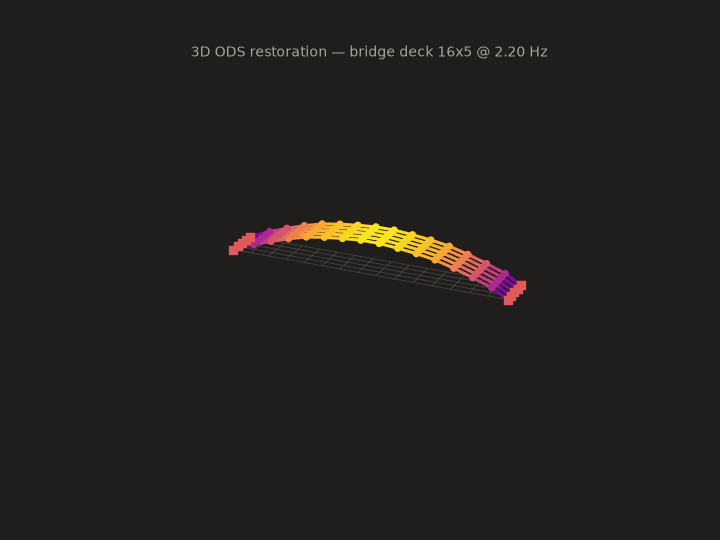

# VibraStudio — NI cDAQ 실시간 진동 해석 스위트

NI cDAQ-9189 + NI-9230(IEPE) 가속도계 시스템을 위한 **18채널 실시간 진동 해석** 데스크톱 애플리케이션입니다.
LabVIEW Sound & Vibration Measurement Suite의 핵심 예제(FFT Analysis, Octave Analysis,
Vibration Level, Frequency Response, Envelope Detection, ODS)를 벤치마킹하여
Python(PySide6 + pyqtgraph)으로 구현했습니다.


## 주요 기능

| 탭 | 기능 | LabVIEW 대응 예제 |
|---|---|---|
| **Time Series** | 18채널 실시간 시계열 (Overlay / Stacked) | Cont Acq&Graph |
| **FFT Spectrum** | 윈도우/평균화(Linear·Exponential·Peak-Hold)·오버랩 FFT, RMS/Peak/dB, 가속도→속도(mm/s)→변위(µm) 주파수영역 적분, PSD(g²/Hz), 피크 자동 라벨, 커서 판독 | Zoom FFT / Power Spectrum |
| **Spectrogram** | 롤링 STFT 워터폴 (inferno 컬러맵, dB) | STFT / Waterfall |
| **Octave** | IEC 61260 1/1·1/3 옥타브 밴드 레벨 | Octave Analysis |
| **Envelope** | 대역통과 + Hilbert 포락선 스펙트럼 (베어링 결함 진단) | Envelope Detection |
| **FRF / Coherence** | 기준 채널 대비 H1 전달률(Transmissibility), 위상, Coherence | Frequency Response (SVXMPL) |
| **Impact Test** | 임팩트 해머 모달 시험 — 레벨 트리거(프리트리거) 자동 캡처, Force/Exponential 윈도우, 타격 평균 **H1 FRF + Coherence**, 고유주파수·감쇠비(half-power, 지수윈도우 보정)·모드형상 자동 추출, 더블히트 자동 리젝트, **응답 방향 필터**(X/Y/Z별 모드 분리), **결과 저장**(frf.csv·modes.csv·raw_hits.npz·meta.json·화면 캡처), 외팔보 이론 기반 **최적 타격 위치 가이드**(모드 노드 회피 표시) | Impact Test (SVMS) |
| **ODS / Modes** | 선택 주파수에서의 운전변형형상(ODS)을 **3D 구조 위에 실시간 애니메이션** — 진폭(자기스펙트럼) + 상대위상(크로스스펙트럼), 피크 자동 탐색. 구조는 파라메트릭 템플릿(보/평판/링/원통 — 예: 12노드×2층 원통)으로 빌드하고 채널을 노드·방향(X/Y/Z)에 자동 매핑 | ODS / Modal 측정 |
| **Metrics** | 채널별 RMS·Peak·Crest·Kurtosis·Skew·지배주파수 라이브 테이블, 충격성(베어링 손상 의심) 플래그 | Vibration Level |

- **레코딩**: 스트리밍 중 NPZ(+메타데이터 JSON, 옵션 CSV) 저장
- **채널 맵**: 18채널(9포인트 × X/Z) 기본 템플릿, 하드웨어 자동 탐지, 포인트/방향/위치/감도(mV/g)/기준 채널 편집, JSON 설정 저장/불러오기
- **시뮬레이션 모드**: 하드웨어 없이 캔틸레버 보 모달 응답(5개 모드 + 회전기계 톤 + 베어링 결함 신호)으로 전 기능 시연 가능


## 실행 파일 (권장 — Python 설치 불필요)

```powershell
# 빌드 (개발 PC에서 1회)
powershell -ExecutionPolicy Bypass -File packaging\build_exe.ps1
```

빌드 결과물 `dist\VibraStudio\VibraStudio.exe` 를 더블클릭하면 바로 실행됩니다.
`dist\VibraStudio` 폴더를 통째로 복사하면 다른 PC에서도 동작합니다
(하드웨어 사용 시 해당 PC에 NI-DAQmx 드라이버만 필요, 시뮬레이션은 아무것도 필요 없음).

## 설치

```powershell
# 1) NI-DAQmx 드라이버 설치 (NI Package Manager) — 시뮬레이션만 쓸 경우 생략 가능
# 2) Python 3.10+ 가상환경
python -m venv .venv312
.\.venv312\Scripts\python.exe -m pip install -r requirements.txt
```

## 실행

```powershell
# 하드웨어 자동 탐지 (없으면 시뮬레이션으로 시작)
.\.venv312\Scripts\python.exe run_app.py

# 시뮬레이션 강제
.\.venv312\Scripts\python.exe run_app.py --simulate
```

1. **Source**에서 Hardware / Simulation 선택 → 샘플링 레이트(NI-9230 최대 12.8 kS/s) 확인
2. **Channels** 카드에서 `Detect HW`로 실제 채널 매핑(현재 4개 센서 연결 시 4채널 자동 인식), 또는 `Default 18ch` 템플릿 사용. 센서 위치(Pos 0~1)·방향(X/Z)·감도(mV/g)·기준(Ref) 채널 설정
3. **▶ Start Streaming** → 탭별 실시간 해석
4. ODS 탭: 스트리밍 상태에서 `Find Peaks` → 피크 선택 → 3D 변형 형상 애니메이션 (`Freeze`로 고정)
5. ODS 3D 구조 빌더: `Shape`(Line/Grid/Circle/Cylinder) 선택 → 파라미터(노드 수·층 수) 입력 →
   `Build Structure` → `Auto-map Channels`(X+Z / X+Y+Z / 단축 매핑). 예: Cylinder, 12 nodes/ring, 2 layers
   = 12노드×2층 원통. 매핑은 채널 테이블의 Pt(노드 id)·Dir 열로 직접 수정 가능하며 Save Config에 함께 저장됨

## 모션 벡터 → 3D ODS 복원 (오프라인 도구)

모션 증폭 장비(RDI Iris M 등)가 출력한 모션 벡터(또는 그 영상)를 입력으로,
ODS 뷰와 같은 원통(cylinder) 노드-링크 구조 위에 3차원 ODS를 복원하고
애니메이션(GIF/MP4)으로 내보내는 헤드리스 도구입니다.

```bash
python tools/ods_from_motion_vectors.py --demo                    # 회전기기(원통)
python tools/ods_from_motion_vectors.py --demo --structure deck   # 교량 상판(grid)
python tools/ods_from_motion_vectors.py --video machine.mp4       # 영상 → optical flow
python tools/ods_from_motion_vectors.py --npz vectors.npz         # 장비 내보내기 데이터

# 실측 예시: 모터 리그 6 Hz 가진 영상. 클립이 시계방향 90° 회전 저장되어
# 있으므로 --rotate 90 으로 바로 세우고, 정지 영역 여러 개로 장면 전체
# 운동(affine)을 제거한 뒤, --check-roi 로 held-out 정지 영역과 비교한다.
python tools/ods_from_motion_vectors.py --video test_vib_6hz.mp4 \
    --rotate 90 --flow-mode direct --detrend affine \
    --roi 135,25,330,330 \
    --ref-roi "0,400,260,600;600,0,690,200;0,0,90,175" \
    --check-roi 430,0,560,70 --out docs/ods_restoration/motor_6hz_checked
# ⚠️ 이 클립은 검사 결과 "복원 불가" 로 판정된다 —
#    아래 「검증」 절과 docs/ods_validation/ 참조.

# 교량 종단간 검증: 합성 교량 영상 생성 → 복원 → 원본 오버레이
python tools/make_bridge_test_video.py bridge_synth.mp4
python tools/ods_from_motion_vectors.py --video bridge_synth.mp4 \
    --structure deck --roi 40,165,600,215 --overlay --overlay-gain 4 \
    --out docs/ods_restoration/bridge_video
```

`--overlay`는 복원된 노드-링크 형상을 단일 스펙트럼 성분으로 프레임별 재구성해
원본 영상 위에 위상 동기로 투영합니다(증폭 배율 화면 표기). 재구성 vs 실측
시계열 상관을 위상 동기 지표로 출력합니다(합성 교량 r=0.988).

### ⚠️ 검증: 복원된 형상이 기계인가 카메라인가

**모델 적합도(R²)는 타당성 지표가 아닙니다.** 원통 모델(스테이션별 병진 +
로킹 + n=2 타원화)이 표현하는 저차 필드는 카메라 회전이 만드는 affine 필드를
그대로 포함하므로, 장면 운동을 덜 제거할수록 R²가 **올라갑니다**. 실측 모터
클립에서 장면 운동 제거 품질을 나쁨→좋음으로 바꾸면 R²는 0.975 → 0.353 으로
떨어지고, 같은 구간에서 held-out 정지 영역 잔차는 3.96 px → 0.33 px 로
좋아집니다. 즉 **가장 옳은 답이 가장 낮은 R²** 를 냅니다.

그래서 두 가지 검사를 제공합니다.

* `--detrend affine` — `--ref-roi` 의 정지 영역들에서 `d = a₀ + a₁x + a₂y`
  를 적합해 프레임 전체에서 뺍니다. 기존의 평균 차감은 offset만 지우고
  기울기를 그대로 남겼는데, 이 클립에서는 그 기울기가 대역 에너지의 83%였고
  정지한 벽·바닥이 기계보다 **더 크게** 움직였습니다. 참조 상자는 `;` 로
  여러 개를 줄 수 있고, 프레임을 가로질러 배치해야 합니다.
* `--check-roi` — `--ref-roi` 에 넣지 않은 정지 영역을 지정하면 기계 대비
  잔차 비를 출력하고, 2배 미만이면 "분리 불가"로 경고합니다.

`tools/ods_synthetic_validation.py` 는 실제 정지 프레임에 **알려진** 변형
형상과 **알려진** 카메라 운동을 주입해 영상을 만들고, 파이프라인이 복원한
결과를 진값 대비 MAC·진폭 이득으로 채점합니다(R²와 달리 카메라 운동을
흡수해서 올릴 수 없는 지표).

```bash
python tools/ods_synthetic_validation.py --base frame.png \
    --machine 135,25,475,330 --amp 2.0 --sweep --out docs/ods_validation
```

전체 진단·수치·선행연구: [docs/ods_validation/](docs/ods_validation/),
논문화 가능성 평가: [docs/paper/](docs/paper/).

### ROI 선별 위상 증폭 (CSP 연산량 절감 연구)

`tools/roi_motion_magnify.py` — 비서브샘플링 complex steerable pyramid 기반
위상 증폭을 전체 프레임 vs 자동 ROI(저해상도 대역 파워 사전 스캔 → 최대
핫스팟 bbox → 미러 패딩 증폭 → 코사인 페더 블렌딩) 두 모드로 실행하고 정량
비교합니다. 실측 모터 영상(120fr 600×690, 5–7 Hz, ×15): 전체 384.5 s →
ROI(프레임의 21.7%) 78.9 s로 **4.9× 고속화**, ROI 내부 충실도 r=0.9999
(NRMSE 0.14%). 결과: [docs/ods_restoration/roi_magnify/](docs/ods_restoration/roi_magnify/)

`tools/roi_segment_benchmark.py`는 여기에 **rough segmentation ROI**(SLIC
슈퍼픽셀을 모션 시드에서 색 유사 이웃으로 성장)를 더해 full/bbox/segment
세 전략을 같은 클립에서 비교하고, ROI가 놓친 모션 비율(captured motion
energy)까지 측정합니다. 모터·손 트래킹 두 영상 결과와 해석:
[docs/roi_segment/](docs/roi_segment/) — 요약하면 세그멘테이션은 **포착률을
고치지만(40.7%→63.2%) 속도는 고치지 못합니다**(비용이 마스크 면적이 아니라
그 bounding box에 비례하기 때문).

측정점별 FFT로 지배 주파수의 복소 진폭·위상을 뽑고(spectral ODS), 축방향
스테이션(링)별 최소자승 적합으로 축방향·수직 병진, 단면 로킹(φ), n=2 타원화를
분리해 원통 노드에 전개합니다. 단일 카메라 시점이라 화면 수직(Y) 병진 성분은
관측 불가하며 0으로 둡니다. 결과 예시:
[docs/ods_restoration/](docs/ods_restoration/) — 다만 실측 모터 예시는 위
「검증」 절의 이유로 물리적 해석을 붙이지 않습니다.

교량(`--structure deck`)은 grid 템플릿 위에 스테이션별 수직 굽힘 dZ·종방향
dX·단면 회전 θ를 적합하며, 독립 적합된 θ가 보 이론의 d(dZ)/dx를 따라가는지가
복원의 내부 일관성 지표가 됩니다(데모 r=0.993).




## 아키텍처

```
vibrastudio/
├── config.py          # 채널 맵 / 수집 / 해석 설정 (JSON 직렬화)
├── daq/
│   ├── engine.py      # NI-DAQmx 연속 수집 백엔드, 링버퍼, 스트리밍 스레드
│   └── simulator.py   # 캔틸레버 모달 응답 시뮬레이터 (실시간 페이싱)
├── dsp/
│   └── analysis.py    # StreamingAnalyzer: 평균화 자기/크로스 스펙트럼,
│                      #  PSD, 적분, FRF/Coherence, ODS, 옥타브, 포락선, 메트릭
├── recorder.py        # 스트림 레코더 (NPZ/CSV, 별도 writer 스레드)
└── ui/
    ├── theme.py       # 다크 테마 (QSS + pyqtgraph)
    ├── panels.py      # 사이드바: 수집/해석/채널/상태 카드
    ├── views.py       # Time/Spectrum/Spectrogram/Octave/Envelope/FRF/Metrics
    ├── ods_view.py    # ODS 애니메이션 뷰
    └── main_window.py # 엔진-분석기-뷰 배선, GUI 틱(60 ms)
```

**신호 처리 방식** — 수집 스레드가 링버퍼에 적재하면 GUI 틱마다 새 샘플을
`StreamingAnalyzer`에 공급합니다. 분석기는 오버랩 블록 단위로 `Sxx = ⟨|X|²⟩`,
`Sxy = ⟨X*ref·X⟩`(기준 채널 크로스 스펙트럼)를 평균화하며, 표시 시점에
Peak/RMS/PSD/dB 스케일과 윈도우 보정(S1/S2)을 적용하므로 단위를 바꿔도
평균 상태가 유지됩니다. ODS는 자기스펙트럼 진폭 + 크로스스펙트럼 상대위상을
사용하는 표준 spectral-ODS 기법입니다.

## 검증

시뮬레이션 모드 스모크 테스트로 검증되었습니다: 18채널 스트리밍 시작 → 8개 탭
전부 렌더 → ODS 피크 탐색(시뮬레이터 모드 주파수 11.6/29.5/72.9/204/400 Hz 검출)
→ 레코딩 시작/정지 → 정상 종료.

## 레거시 스크립트

초기 테스트 스크립트는 [legacy/](legacy/)로 이동했습니다
(단일 채널 뷰어, 10초 캡처, 캡처 후 모달 분석 GUI).

## 요구 사항

- Windows + NI-DAQmx 런타임 (하드웨어 사용 시)
- Python 3.10+, PySide6, pyqtgraph, numpy, scipy, nidaqmx
