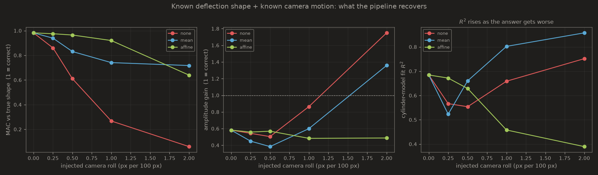

# Is the restored ODS the machine, or the camera?

This directory documents a correction. The first version of
`tools/ods_from_motion_vectors.py` restored a 3D operating deflection shape
from the 6 Hz motor clip and reported a high model-fit `R²`. That number was
not evidence the restoration was right. It was, it turns out, the opposite.

## What went wrong

Three separate defects, in increasing order of severity.

**1. Orientation.** The clip is stored rotated 90° clockwise. `ffmpeg` shows
no rotation metadata in either test clip, so the sideways storage is real and
nothing downstream corrected for it. Fixed with `--rotate 90`.

**2. Machine axis.** The axis was hand-picked as `--angle 15.3` in the stored
portrait frame. Measured from the data, the axis sits at −76.2° there, so
axial and transverse were effectively swapped: what the animation labelled
"vertical bending" was mostly axial.

**3. Integration drift.** Motion vectors were built by integrating
frame-to-frame optical flow. Against a direct frame-to-reference measurement
the two disagree by 0.616 px median / 4.442 px at p90 after 120 frames, on a
signal of ~2.5 px. `--flow-mode direct` is now the default.

Those three are ordinary bugs. The fourth is not.

## The real problem: the scene moves, not the machine

Fit a complex affine field `d = a₀ + a₁x + a₂y` to the 6 Hz band of the whole
frame, and it explains **83% of the band energy** — including over the wall,
the floor, and the aluminium extrusion, none of which are attached to the
machine. Measured region by region on the raw flow:

| region | 6 Hz amplitude (raw) |
|---|---|
| motor casing | 1.68 px |
| gearbox / shaft | 1.26 px |
| blue pulley | 0.63 px |
| **wall (static)** | **2.03 px** |
| **aluminium extrusion (static)** | **2.15 px** |

The static background moves *more* than the machine. The field is a shear,
`du/dy ≈ 13 px per 100 px` with `dv/dx ≈ 2.7`, growing toward one edge of the
frame — a camera that rocks, not one that shifts. The existing `--ref-roi`
subtracted only the *mean* of a reference region, which cancels an offset and
leaves a gradient completely intact.

### Removing it, and what survives

`--detrend affine` fits that gradient on one or more static reference boxes
(now `;`-separated, so they can straddle the frame) and subtracts the fitted
field everywhere. With three boxes — plate, top-right extrusion, top-left
frame — the analysis line at 6.05 Hz leaves:

| region | amplitude after removal | narrowband SNR |
|---|---|---|
| motor casing | 0.298 px | 407 |
| gearbox | 0.539 px | 1986 |
| blue pulley | 0.280 px | 301 |
| **wall (static)** | **0.655 px** | **1440** |
| **floor (static)** | **0.602 px** | **1438** |

The static wall and floor still retain *more* coherent 6 Hz motion than the
motor casing does. Whatever the residual is — parallax across depth, rolling
shutter, a camera field that is not exactly affine — it is not separable from
the machine's own deformation at this amplitude. **For this clip there is no
recoverable machine ODS at 6 Hz.** The published animation was rendering
scene motion as a deflection shape.

### Why the R² pointed the wrong way

The cylinder model is per-station translation plus rocking plus an n=2 ring
term. A smooth scene-wide gradient is *exactly* the kind of field that basis
represents well. So the worse the scene-motion removal, the better the fit:

| scene-motion removal | held-out static residual | casing amplitude | best-fit R² |
|---|---|---|---|
| top-right box only (bad fit) | 3.96 px | 2.617 px | **0.975** |
| plate only | 0.965 px | 0.718 px | 0.730 |
| plate + top-right | 0.749 px | 0.487 px | 0.534 |
| plate + both tops (best) | 0.330 px | 0.288 px | **0.353** |

R² is monotonically *anti*-correlated with the quality of the answer. The same
holds for the assumed axis: R² keeps climbing as the assumed axis rotates away
from the machine's visible axis (−15° → +51°), because a rotated frame lets
the model absorb the gradient more efficiently.

A model-fit R² is therefore not a validity metric for this problem, and the
one previously printed as `[3b] model fit R^2` should not be read as one.

## What replaces it

**A held-out static region.** `--check-roi x0,y0,x1,y1` names a static region
kept *out* of `--ref-roi` and reports how much analysis-line motion survives
there against the machine's. If the machine is not at least 2× the static
region, the tool says so and tells you the shape is unresolved.

**A ground-truth test.** `tools/ods_synthetic_validation.py` warps a real
still frame by a *known* deflection shape confined to a machine region, adds a
*known* whole-scene affine motion at the same frequency, and scores what the
pipeline recovers by MAC against the injected shape and by amplitude gain.
Unlike R², neither can be inflated by absorbing camera motion, because the
answer is known.

### What the ground-truth test says

A cantilever-like shape with a 2.0 px free-end deflection is injected into the
motor region of a real still frame, and a camera roll of increasing amplitude
is injected over the whole frame at the same 6 Hz. Scene displacement is
quoted as the peak whole-frame camera motion in pixels.

| scene motion | detrend | MAC vs truth | amplitude gain | model R² |
|---|---|---|---|---|
| 0.00 px | any | 0.982 | 0.58 | 0.685 |
| 0.99 px | none | 0.860 | 0.54 | 0.567 |
| 0.99 px | mean | 0.939 | 0.45 | 0.523 |
| 0.99 px | **affine** | **0.975** | 0.56 | 0.672 |
| 1.98 px | none | 0.611 | 0.50 | 0.554 |
| 1.98 px | mean | 0.831 | 0.38 | 0.660 |
| 1.98 px | **affine** | **0.965** | 0.57 | 0.629 |
| 3.95 px | none | 0.268 | 0.86 | 0.659 |
| 3.95 px | mean | 0.741 | 0.60 | 0.802 |
| 3.95 px | **affine** | **0.920** | 0.48 | 0.458 |
| 7.90 px | none | 0.060 | 1.75 | 0.752 |
| 7.90 px | mean | 0.717 | 1.36 | 0.858 |
| 7.90 px | affine | 0.640 | 0.49 | 0.390 |



Four things fall out of this.

**Scene motion of ~2 px is already enough to halve the shape fidelity** if it
is not removed (MAC 0.982 → 0.611), and ~4 px destroys it (0.268). The real
motor clip carries ~2.9 px. That is precisely the regime in which the original
result was produced.

**Affine removal holds MAC ≥ 0.92 out to ~4 px** of scene motion, where
mean-only removal has already fallen to 0.741 and no removal to 0.268. Beyond
that the affine fit itself degrades (0.640 at 7.9 px) because the reference
regions no longer constrain a field that large.

**R² does not track correctness.** Over the 15 runs its correlation with the
true MAC is **r = −0.162** — slightly negative, effectively none. The sharpest
pair: at 7.90 px with no detrending the recovered shape is completely wrong
(MAC 0.060) and reports R² 0.752; at 3.95 px with affine removal the shape is
nearly right (MAC 0.920) and reports R² 0.458. **The worse answer has the
higher R².**

**Amplitude gain is a usable warning even without ground truth.** Whenever the
shape is right the gain sits at 0.5–0.6; it climbs past 1.0 (1.75, 1.36) only
in the runs where the shape has collapsed. Scene motion inflates reported
deflection, it does not shrink it.

That 0.5–0.6 gain is itself a finding: **even with the camera perfectly still
and the shape recovered at MAC 0.982, the pipeline under-reports amplitude by
about 43%.** Per-station least squares averages over points whose true
deflection varies within the station, and Farneback smooths sub-pixel motion.
Absolute amplitudes from this pipeline should not be quoted without a
calibration.

A caveat on the test itself: the injected scene motion is a *roll* rather than
a horizontal shear, deliberately. A roll has a vertical component that
competes with the transverse deflection being measured. An earlier version of
this test injected horizontal shear only, and the pipeline scored MAC ≥ 0.98
at every amplitude with no detrending at all — it passed because the
disturbance and the measurand never overlapped, not because it separated
them.


## Prior art

Camera-motion compensation from static reference regions is standard practice
in video-based structural monitoring, using affine or homography estimates on
reference templates — the pipeline was simply missing it. Camera ego-motion
is explicitly recognised there as able to *dominate* the observed structural
vibration. Video ODS extraction from optical flow, and phase-based ODS
magnification, are likewise established. Full-field 3D ODS from cameras is
addressed by frequency-domain triangulation and by multiview Spectral Optical
Flow Imaging, which need multiple views precisely because a single 2D view
cannot resolve motion along the optical axis.

Against that background, restoring single-view motion vectors onto a
parametric node-link geometry is a reasonable engineering idea, but it is not
by itself a contribution, and the results in this repository do not currently
support one. See `docs/paper/README.md` for the assessment.

## Reproducing

```bash
# ground-truth sweep
python tools/ods_synthetic_validation.py --base frame.png \
    --machine 135,25,475,330 --amp 2.0 --sweep --shears 0,0.25,0.5,1.0,2.0 \
    --out docs/ods_validation

# the motor clip, with the checks on
python tools/ods_from_motion_vectors.py --video test_vib_6hz.mp4 \
    --rotate 90 --flow-mode direct --detrend affine \
    --roi 135,25,330,330 \
    --ref-roi "0,400,260,600;600,0,690,200;0,0,90,175" \
    --check-roi 430,0,560,70 \
    --out docs/ods_restoration/motor_6hz_checked
```
