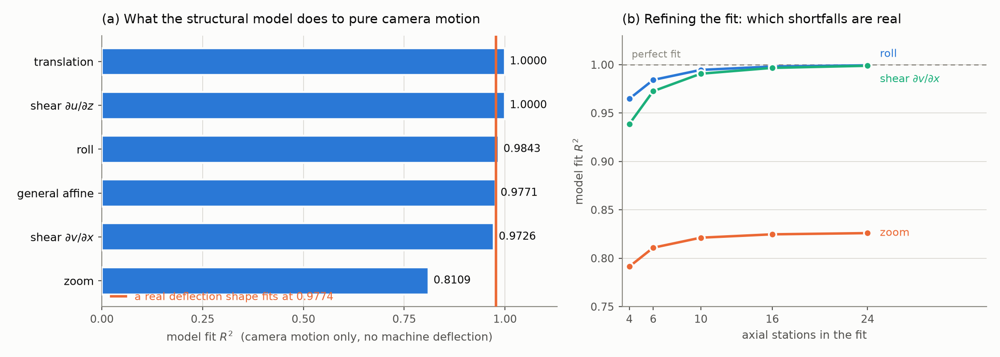
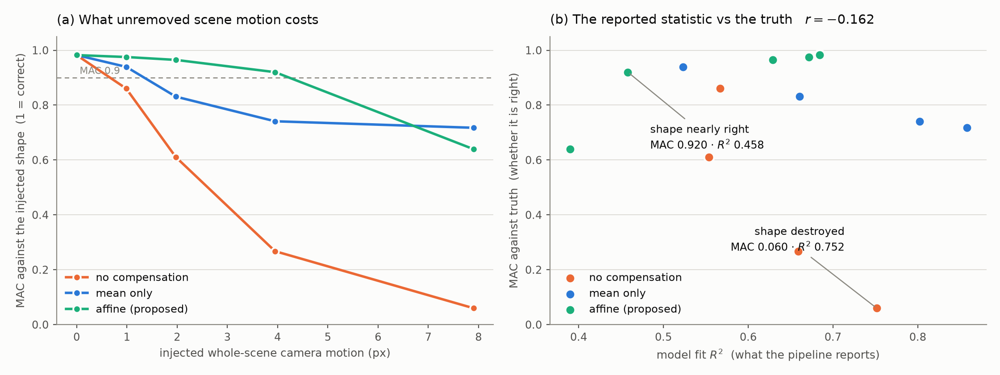
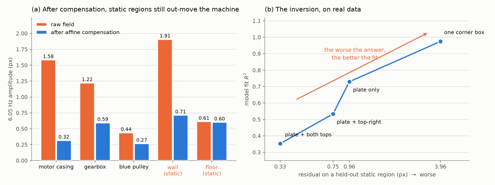

# Goodness-of-fit is not validity: residual camera motion in model-based operating deflection shapes from video

**Draft v0.1** — status: analysis and controlled experiment complete; field
case is a negative result; reference-sensor validation outstanding (§8).

---

## Abstract

Video-based operating deflection shape (ODS) measurement increasingly fits
the measured full-field motion to a parametric structural model — beam
stations, section rotation, cross-section ovalization — both to regularise
noisy optical flow and to produce a 3D shape from a single view. When no
reference accelerometer is available, the goodness-of-fit of that model is
the natural self-check, and is commonly the only quantitative validity
figure reported.

We show that this check is not merely weak but *inverted*. Residual camera
ego-motion produces an affine displacement field, and we prove that the
affine field lies inside the span of the structural model: for a
cylinder-station model, camera translation and image-shear are fitted with
R² = 1.0000 exactly, and camera roll converges to 1 as station binning is
refined. In a controlled experiment with a known injected deflection shape
and known injected camera roll, the correlation between model R² and the
true modal assurance criterion (MAC) against the injected shape is
**r = −0.162** over 15 runs: a run whose recovered shape is destroyed
(MAC 0.060) reports R² 0.752, while a run whose shape is nearly correct
(MAC 0.920) reports R² 0.458. On a real 6 Hz motor clip the same inversion
appears — R² falls monotonically from 0.975 to 0.353 as scene-motion removal
is improved from bad to good.

We quantify the damage (≈2 px of unremoved scene motion halves shape
fidelity; ≈4 px destroys it), show that an affine detrend fitted on static
reference regions holds MAC ≥ 0.92 out to ≈4 px, and propose four
internal-consistency checks that can be reported in place of fit quality
when no reference sensor exists. Applying them to our own previously
published result retracts it: the motor clip contains no separable machine
ODS at 6 Hz.

---

## 1. Introduction

A camera pointed at a running machine measures every pixel at once, which is
what makes video attractive for ODS work: no accelerometer mass loading, no
cabling, hundreds of effective measurement points. Two families of technique
dominate — phase-based motion magnification for visualisation, and optical
flow for quantitative displacement extraction.

Both produce a 2D field. Turning that field into an *operating deflection
shape* on a structure usually means fitting it to something: a set of axial
stations, a beam model, a parametric geometry. The fit does real work. It
denoises, it separates axial from transverse response, and — for a single
camera — it is the only route to a 3D shape, since one view cannot resolve
motion along the optical axis.

Having fitted a model, the natural question is whether the fit is any good,
and the natural answer is a goodness-of-fit statistic: R², residual norm,
explained variance. In the absence of a reference sensor, this is often the
only quantitative claim of validity a video ODS result carries.

This paper argues that the statistic answers a different question than the
one being asked, and answers it in a way that is actively misleading. The
argument is in three parts: an identifiability analysis (§4), a controlled
experiment with ground truth (§5), and a field case where following the
statistic produced a confidently wrong result that we retract (§6).

**Contributions.**

1. A proof, with numerical confirmation, that the affine field produced by
   camera ego-motion lies inside the span of a standard cylinder-station ODS
   model — exactly, for translation and image shear (§4).
2. A controlled experiment quantifying the resulting inversion: R² is
   uncorrelated-to-anticorrelated with true shape fidelity (r = −0.162), and
   ≈2 px of unremoved scene motion halves MAC (§5).
3. A field case demonstrating the failure on real data, and the retraction
   of a previously published deflection shape (§6).
4. Four sensor-free internal-consistency checks that do have discriminating
   power, with the discriminating one identified (§7).

---

## 2. Related work

**ODS from video.** Extraction of operating deflection shapes directly from
optical flow, with automatic masking and frame-wise fusion, is established
[Machynia et al., *Sensors* 2021]. Phase-based Eulerian motion magnification
has been used to visualise ODS at magnifications up to ×400 and to identify
modal parameters of civil structures [Chen et al., IMAC 2015]. Commercial
systems (RDI Iris M, gfaitech WaveCam) productise the workflow.

**3D ODS from cameras.** A single 2D view cannot resolve motion along the
optical axis. Frequency-domain triangulation and multiview Spectral Optical
Flow Imaging recover full-field 3D ODS using multiple views precisely for
this reason [Gorjup, Slavič, Boltežar]. Fitting a single view to a
parametric 3D geometry, as studied here, is the cheap alternative — and, as
§4 shows, the one that opens the identifiability hole.

**Camera motion compensation.** That camera ego-motion can dominate measured
structural vibration is well known in vision-based structural health
monitoring, and compensation using static reference regions — affine or
homography transforms estimated on reference templates outside the structure
— is standard practice. Our contribution is not the compensation itself but
the demonstration that its *absence* is rewarded by the fit statistic, so a
pipeline missing it receives no warning and in fact receives encouragement.

**Goodness-of-fit critiques.** That R² rewards added parameters and does not
establish model correctness is elementary statistics. What is specific here
is the structural coincidence: the nuisance field and the signal model are
not merely both flexible, they overlap *exactly*, which makes the statistic
not just uninformative but reversed.

---

## 3. Method under study

We study the pipeline in the accompanying repository, which is
representative of the class. Motion vectors are obtained by dense
Farneback optical flow measured frame-to-reference. A Hann-windowed FFT per
point gives complex amplitude and phase at the analysis line. Points are
binned into axial stations along the machine axis, and per station j a
complex linear least-squares fit separates

$$u(\theta) = dX_j + \varphi_j \,(z/R)$$
$$v(\theta) = dZ_j + \left[a_{2,j}\cos 2\theta + b_{2,j}\sin 2\theta\right]\cos\theta$$

where $u,v$ are image-horizontal and image-vertical displacement, $\theta$
is the circumferential angle of the point on the visible face, $dX_j$ is
axial translation, $\varphi_j$ is section rocking, $dZ_j$ is transverse
translation, and $a_2, b_2$ are the $n=2$ ovalization coefficients projected
onto the visible face. Out-of-plane translation is unobservable from one
view and set to zero. The station fits are expanded onto the nodes of a
parametric cylinder geometry to give a 3D shape.

The reported fit statistic is

$$R^2 = 1 - \frac{\sum |d_{\text{meas}} - d_{\text{pred}}|^2}{\sum |d_{\text{meas}} - \bar{d}_{\text{meas}}|^2}$$

over all measurement points, with $d = (u,v)$ complex.

---

## 4. The structural model spans the camera field

### 4.1 Analysis

Let the camera undergo a small rigid motion between the reference frame and
frame $t$. To first order the induced image displacement of a
sufficiently distant, sufficiently planar scene is affine:

$$\mathbf{d}(\mathbf{p}) = \mathbf{A}\mathbf{p} + \mathbf{t}, \qquad
\mathbf{A} = \begin{bmatrix} a_{11} & a_{12} \\ a_{21} & a_{22}\end{bmatrix}$$

Camera translation contributes $\mathbf{t}$; roll about the optical axis
contributes the antisymmetric part of $\mathbf{A}$; pan and tilt contribute,
to first order, further translation; dolly contributes the isotropic part.

Write this per axial station. Within station $j$ the axial coordinate is
$x = x_j$, constant; the transverse coordinate $z$ varies across the ring.
Then

$$u = \underbrace{(t_u + a_{11}x_j)}_{\text{constant}} + \underbrace{a_{12}z}_{\text{linear in } z}$$
$$v = \underbrace{(t_v + a_{21}x_j)}_{\text{constant}} + \underbrace{a_{22}z}_{\text{linear in } z}$$

Compare with the model. The $u$ row is spanned **exactly**: the constant
term is $dX_j$ and the term linear in $z$ is precisely the rocking DOF
$\varphi_j (z/R)$. There is no residual, for any camera motion, ever.

The $v$ row is spanned in its constant term by $dZ_j$. Its term linear in
$z$ has no dedicated DOF, and must be supplied by the ovalization basis.
With $z = R\sin\theta$,

$$\sin 2\theta\cos\theta = \tfrac{1}{2}\left(\sin\theta + \sin 3\theta\right)$$

so the $b_2$ coefficient buys the required $\sin\theta$ only in fixed 1:1
company with a $\sin 3\theta$ the field does not contain. **The entire
residual of an affine camera field, under this model, is that unwanted
$\sin 3\theta$** — and any camera motion whose $v$ does not vary with $z$
(translation, roll, $\partial v/\partial x$ shear) leaves no residual at all.

### 4.2 Numerical confirmation

We fed the fitter camera fields containing **zero machine deflection** and
recorded the R² it returned (`tools/ods_identifiability.py`).

**Figure 1** — (a) Model fit R² for pure camera fields with no machine
deflection present; the vertical line marks where a genuine cantilever
deflection fits. Two camera fields are fitted *perfectly*, and three fit
better than the real deflection does. (b) Refining the axial station count
separates the two kinds of shortfall: roll and $\partial v/\partial x$
converge to 1, so their residual was only binning width, while zoom
plateaus at the $\sin 3\theta$ drag predicted in §4.1.

**Table 1** — R² for pure camera fields, no machine deflection present.

| camera field | R² (+rocking) | R² (no rocking) |
|---|---|---|
| translation | **1.0000** | 1.0000 |
| roll | 0.9843 | 0.5593 |
| shear $\partial u/\partial z$ | **1.0000** | 0.0000 |
| shear $\partial v/\partial x$ | 0.9726 | 0.9726 |
| zoom | 0.8109 | 0.8109 |
| general affine | 0.9771 | 0.4654 |
| *(for contrast)* true cantilever bending $v \sim x^2$ | *0.9774* | — |

Three things follow.

**The exact cases are exact.** Translation and $\partial u/\partial z$ shear
return R² = 1.0000. A pipeline reporting a perfect fit may be looking at a
scene with no structural motion in it whatsoever.

**The near-exact cases are limited only by station binning.** Roll and
$\partial v/\partial x$ shear put a term linear in $x$ into $v$; since a
ring spans a range of $x$, the station fit absorbs it only to binning
resolution. Refining the stations confirms the prediction:

**Table 2** — R² against station count.

| camera field | 4 | 6 | 10 | 16 | 24 |
|---|---|---|---|---|---|
| roll | 0.9647 | 0.9843 | 0.9946 | 0.9981 | **0.9994** |
| shear $\partial v/\partial x$ | 0.9387 | 0.9726 | 0.9907 | 0.9967 | **0.9989** |
| zoom | 0.7914 | 0.8109 | 0.8213 | 0.8247 | 0.8260 |

Roll and $\partial v/\partial x$ converge to 1; their shortfall was never
structural. Zoom plateaus at ≈0.83, and that plateau is exactly the
$\sin 3\theta$ drag predicted in §4.1 — the only part of an affine field the
model genuinely cannot absorb.

**A real deflection shape fits no better than camera motion.** The cantilever
bending case returns R² = 0.9774 — *lower* than translation (1.0000), lower
than $\partial u/\partial z$ shear (1.0000), lower than roll at any station
count above 6, and statistically indistinguishable from the general affine
camera field (0.9771). This is the crux: **R² has no discriminating power
between the signal and the nuisance, because the nuisance is inside the
model space.**

### 4.3 The rocking DOF is the mechanism

Table 1 also shows the cost of the modelling choice. Adding the section
rocking DOF $\varphi_j$ raises the fit of $\partial u/\partial z$ camera
shear from 0.0000 to 1.0000, and of general affine camera motion from 0.4654
to 0.9771. Rocking is physically well motivated — machines do rock on their
mounts — but it is also *precisely* the shape a rolling camera writes into
$u$. A DOF added to capture real physics silently doubled as the absorber
for the dominant artefact.

---

## 5. Controlled experiment

### 5.1 Design

Analysis says the model can absorb camera motion. The operational question
is how much shape error that buys at realistic amplitudes. We built a
harness with ground truth (`tools/ods_synthetic_validation.py`):

1. Take a real still frame of the machine, so texture, contrast and flow
   behaviour are realistic.
2. Warp it by a **known** deflection shape — cantilever-like,
   $s(x) = x^2(3-2x)$, 2.0 px peak at the free end — confined to the machine
   region.
3. Add a **known** whole-scene camera roll at the same frequency, swept in
   amplitude.
4. Run the pipeline and score the recovered station profile against the
   injected shape by MAC, and the recovered peak against the injected peak
   as an amplitude gain.

MAC and gain cannot be inflated by absorbing camera motion, because the truth
is known independently of the fit.

Two design points matter. First, the injected scene motion is a **roll**,
not a horizontal shear. An earlier version of this experiment injected
horizontal shear while the machine deflected vertically; the pipeline scored
MAC ≥ 0.98 at every amplitude with no compensation at all, because the
disturbance and the measurand never overlapped. It passed for the wrong
reason. A roll has a vertical component that competes directly with the
transverse deflection being measured. Second, the amplitude sweep is capped
so that whole-frame camera displacement stays inside the optical-flow
capture range; beyond that the breakdown measured is Farneback's, not the
method's.

### 5.2 Results

**Figure 2** — (a) Shape fidelity against injected camera motion for the
three compensation modes. (b) The same 15 runs plotted as reported
statistic against actual correctness; a useful self-check would trend up and
to the right, and this one does not.

**Table 3** — MAC against the injected shape.

| scene motion | detrend: none | mean | **affine** |
|---|---|---|---|
| 0.00 px | 0.982 | 0.982 | 0.982 |
| 0.99 px | 0.860 | 0.939 | **0.975** |
| 1.98 px | 0.611 | 0.831 | **0.965** |
| 3.95 px | 0.268 | 0.741 | **0.920** |
| 7.90 px | 0.060 | 0.717 | 0.640 |

**Uncompensated scene motion of ≈2 px halves shape fidelity** (0.982 →
0.611) and ≈4 px destroys it (0.268). Affine compensation fitted on static
reference regions holds MAC ≥ 0.92 out to ≈4 px. Mean-only compensation —
subtracting the average displacement of a reference region, which cancels an
offset but leaves the gradient intact — recovers only part of the loss.
Beyond ≈8 px the affine fit itself degrades, as the reference regions no
longer constrain a field that large.

**Table 4** — the same runs scored by model R².

Correlation between model R² and true MAC over all 15 runs: **r = −0.162**.
Not weakly positive; slightly negative. The sharpest pair:

| | MAC (truth) | R² (reported) |
|---|---|---|
| 7.90 px, no compensation | **0.060** | 0.752 |
| 3.95 px, affine compensation | **0.920** | 0.458 |

The run whose recovered shape is destroyed reports a fit statistic 1.6×
better than the run whose shape is nearly correct.

### 5.3 Two by-products worth reporting

**Amplitude gain is a usable warning even without ground truth.** Recovered
peak over true peak sits at 0.5–0.6 in every run where the shape is
essentially correct, and climbs past 1.0 (1.75, 1.36) only in runs where the
shape has collapsed. Scene motion *inflates* reported deflection; it never
shrinks it. A video ODS reporting larger amplitudes than expected should be
suspected, not celebrated.

**The pipeline under-reports amplitude by ≈43% even when correct.** With the
camera perfectly still and MAC 0.982, gain is 0.58. Two mechanisms:
per-station least squares averages over points whose true deflection varies
within the station, and Farneback smooths sub-pixel motion. Absolute
amplitudes from this class of pipeline require calibration before they are
quoted in engineering units.

---

## 6. Field case, and a retraction

### 6.1 The clip

A 30 fps handheld-class recording of a small motor rig on an optical
breadboard, excited at 6 Hz, with the motor casing, a gearbox, a shaft and a
belt pulley in view along with a wall, floor and an aluminium extrusion frame
that are not attached to the rig.

A previously published run of our own pipeline on this clip produced a 3D
deflection shape with a drive-end-to-free-end amplitude growth of
0.85 px → 2.4 px, described as vertical bending, and reported a model fit of
R² = 0.99.

### 6.2 What the clip actually contains

**Figure 3** — (a) 6 Hz amplitude by region on the motor clip, before and
after affine compensation. Regions marked static are not attached to the
rig. In the raw field the wall out-moves the motor casing (1.91 vs 1.58 px);
the floor does not, being nearer the quiet end of the camera gradient. After
compensation **both** static regions retain more than the casing (0.71 and
0.60 vs 0.32 px), which is the comparison that matters — it is the residual
the restoration actually works from. (b) Varying only the quality of the
compensation traces out the inversion: the fit statistic climbs as the
answer gets worse.

Panel (a) is recomputed at figure time on a coarser grid than Tables 5–6,
which used per-region hand-placed boxes; the two agree to within a few
hundredths of a pixel where the regions coincide (floor 0.602 vs 0.60,
pulley 0.280 vs 0.27) and differ where they do not (Table 5's third static
region is the aluminium extrusion, high in the frame; the figure's is the
floor, lower and quieter).

Fitting a complex affine field to the whole frame at the analysis line
explains **83% of the 6 Hz band energy**. Measured region by region on the
raw field:

**Table 5** — raw 6 Hz amplitude by region.

| region | amplitude |
|---|---|
| motor casing | 1.68 px |
| gearbox / shaft | 1.26 px |
| blue pulley | 0.63 px |
| **wall (static)** | **2.03 px** |
| **aluminium extrusion (static)** | **2.15 px** |

The static background moves *more* than the machine. The field is a shear,
$\partial u/\partial y \approx 13$ px per 100 px — a camera that rocks, not
one that shifts, which is exactly the case §4 shows the model absorbs
through its rocking DOF.

After affine compensation fitted on three static reference boxes straddling
the frame:

**Table 6** — residual after compensation, with narrowband SNR.

| region | residual | narrowband SNR |
|---|---|---|
| motor casing | 0.298 px | 407 |
| gearbox | 0.539 px | 1986 |
| blue pulley | 0.280 px | 301 |
| **wall (static)** | **0.655 px** | **1440** |
| **floor (static)** | **0.602 px** | **1438** |

The static wall and floor retain *more* coherent 6 Hz motion than the motor
casing does. Whatever the residual is — parallax across depth, rolling
shutter, a camera field that is not exactly affine — it is not separable
from the machine's own deformation at this amplitude. **This clip contains
no recoverable machine ODS at 6 Hz.**

### 6.3 The inversion on real data

Varying only the quality of the scene-motion removal:

**Table 7** — fit statistic against actual answer quality.

| scene-motion removal | held-out static residual | casing amplitude | best-fit R² |
|---|---|---|---|
| one corner box (bad fit) | 3.96 px | 2.617 px | **0.975** |
| plate only | 0.965 px | 0.718 px | 0.730 |
| plate + top-right | 0.749 px | 0.487 px | 0.534 |
| plate + both tops (best) | 0.330 px | 0.288 px | **0.353** |

R² is monotonically anti-correlated with the quality of the compensation.
The same holds for the assumed machine axis: undetrended, R² climbs from
0.833 at the machine's visible axis (−15°) to 0.943 at +51°, i.e. the fit
improves as the model is pointed *away* from the machine, because a rotated
frame lets it absorb the gradient more efficiently.

### 6.4 Retraction

The published result is withdrawn. The 0.85 px → 2.4 px profile was the
camera's gradient, not the machine's deflection; the 2.4 px end was further
inflated by drift in accumulated frame-to-frame optical flow (0.616 px
median, 4.442 px p90 over 120 frames, against a ~2.5 px signal). Three
ordinary bugs contributed — the clip is stored rotated 90° and was analysed
sideways, the machine axis was set to +15.3° when the data puts it at
−76.2° in that frame (swapping axial and transverse), and the flow was
accumulated rather than measured against a reference — but none of them is
the reason the result looked convincing. It looked convincing because
R² = 0.99, and R² = 0.99 is what §4 predicts for a scene dominated by camera
roll.

---

## 7. What to report instead

No single statistic replaces a reference sensor. Four internal-consistency
checks, each asking a question that a genuine deflection answers differently
from residual camera motion, are implemented in
`tools/ods_sensorless_validation.py`.

| check | rules out | needs |
|---|---|---|
| **static region** | scene motion, directly | one clip |
| **split-half** | non-stationarity, flow noise | one clip |
| **repeat** | camera artefacts, near-conclusively | **two recordings** |
| **order lock** | anything ignorant of shaft speed | one clip + known rpm |

**Static region.** Hold a region that cannot be moving *out* of the
compensation reference set and measure what survives there at the analysis
line, relative to the structure. On the §6 clip this returns machine
0.295 px vs static 0.714 px, a ratio of 0.41× — the check fires. We propose
a ratio ≥ 2 as a necessary precondition for any downstream claim, with the
threshold characterised in §5's controlled data.

Two implementation points, both learned by pointing the check at the §6 clip
as a control. First, the ratio must be measured **after** the same
compensation the restoration applies; measured on the raw field, on a clip
whose dominant field is a gradient, it compares the gradient's hot end to
its cold end and flatters any structure that happens to sit at the hot end
(2.00× / usable becomes 0.44× / reject when corrected). Second, regions
chosen automatically from band power pick the two ends of that same
gradient, so automatically chosen regions must return *unconfirmed* rather
than a verdict.

**Split-half.** Restore from the first and second halves of one recording
independently and correlate. Necessary but **not sufficient**, and the §6
clip is the counterexample: it scores MAC 1.000. Both halves share the same
camera, so a steady camera-driven "shape" reproduces perfectly. A check that
cannot distinguish a steady camera from a steady machine should never be
reported alone.

**Repeat.** Restore from two *separate recordings* of the same machine state
and correlate. Camera motion is uncorrelated between recordings — a
different tripod settling, a different phase of building sway — while the
machine's deflection shape is not. This is the one that justifies changing
how data is captured, and the one we could not run (§8).

**Order lock.** For rotating machinery, response concentrates at integer
orders of running speed. Given the rpm, report the deviation of the
dominant peak from 1× and the order-locked share of band energy. Building
sway, hand shake and rolling shutter do not know the shaft speed. This is
nearly free and should be standard whenever the speed is known.

---

## 8. Limitations

**No reference sensor.** Every claim about the real clip rests on video
alone. Two accelerometers are visible in the frame; their signals were not
available. This is the single largest gap and the first thing to close.

**The field case is negative.** §6 demonstrates the failure mode but is not
a demonstration that the restoration works when conditions are good. A
tripod-mounted, higher-amplitude, global-shutter recording would supply the
positive case. We screened all available footage against §7's checks and
none passed — every clip failed on the scene-motion ratio, on reproduction
within its own recording, or on length.

**The repeat check is unexercised.** It is the strongest of the four and has
not been run on real data, because it needs two independent recordings of
one machine state and we have none. High-speed footage of a 1800 rpm rig
with repeat runs and a hard-versus-soft bolting contrast exists but was not
retrievable in our environment.

**One geometry.** The analysis in §4 is worked for the cylinder-station
model. The argument generalises to any low-order structural basis containing
per-station translation and a rotation-like DOF — which is most of them —
but the exact R² values are model-specific.

**First-order affine.** Real camera motion over a scene with depth is not
exactly affine. Parallax is precisely what we suspect remains in Table 6's
static-region residual, and a compensation model richer than affine may
recover more.

---

## 9. Conclusion

The goodness-of-fit of a structural model, computed on the same field it was
fitted to, cannot validate a video-derived operating deflection shape,
because the dominant nuisance — residual camera ego-motion — lies inside the
model's span. For the cylinder-station model studied here it lies inside
*exactly* for camera translation and image shear, and to within station
binning for camera roll. A real deflection shape fits no better than a pure
camera field, and in our controlled experiment the fit statistic is slightly
anti-correlated (r = −0.162) with true shape fidelity.

The practical consequences are concrete: compensate scene motion with an
affine field fitted on static reference regions rather than a mean offset;
hold a static region out of that fit and report what survives there; treat
split-half reproduction as necessary rather than sufficient; record twice
and report the cross-recording MAC; and, for rotating machinery, report
order lock against the known shaft speed. Report amplitude gain as a warning
flag, and calibrate before quoting absolute deflections.

We applied these to our own prior result and withdrew it. We suggest the
same test is worth applying to any video ODS whose only quantitative claim
of validity is that the model fitted well.

---

## Reproducibility

| result | command |
|---|---|
| Tables 1–2 | `python tools/ods_identifiability.py` |
| Tables 3–4 | `python tools/ods_synthetic_validation.py --base frame.png --machine 135,25,475,330 --amp 2.0 --sweep --shears 0,0.25,0.5,1.0,2.0` |
| Tables 5–7, §6 | `python tools/ods_from_motion_vectors.py --video test_vib_6hz.mp4 --rotate 90 --flow-mode direct --detrend affine --roi 135,25,330,330 --ref-roi "0,400,260,600;600,0,690,200;0,0,90,175" --check-roi 430,0,560,70` |
| §7 checks | `python tools/ods_sensorless_validation.py screen *.mp4 --rpm 1800` |
| Figures 1–3 | `python tools/paper_figures.py --out docs/paper/figs --video test_vib_6hz.mp4` |

Figures 1 and 3 are computed at figure time from the identifiability
experiment and the clip itself; Figure 2 is read from the stored sweep in
`docs/ods_validation/validation.json`. The only transcribed numbers in any
figure are Table 7's compensation-quality sweep, in Figure 3(b).

Supporting data and figures: `docs/ods_validation/`. Clip survey and
screening results: `docs/ods_validation/CLIPS.md`.

---

## References

*(to be completed — currently identified from survey)*

1. Machynia, Dworakowski, Dziedziech, Zdziebko, Konieczny, Holak.
   Operational Deflection Shapes Magnification and Visualization Using
   Optical-Flow-Based Image Processing. *Sensors*, Dec 2021.
2. Chen et al. Developments with Motion Magnification for Structural Modal
   Identification Through Camera Video. *IMAC* 2015.
3. Gorjup, Slavič, Babnik, Boltežar. Still-camera multiview Spectral Optical
   Flow Imaging for 3D operating-deflection-shape identification. *MSSP*
   2021.
4. Gorjup, Slavič, Boltežar. Frequency domain triangulation for full-field
   3D operating-deflection-shape identification. *MSSP* 2019.
5. Feng, Feng. Video Camera–Based Vibration Measurement for Civil
   Infrastructure Applications. *J. Infrastructure Systems* 23(3), 2017.
6. Wadhwa et al. Phase-based video motion processing. *ACM TOG* 2013.
